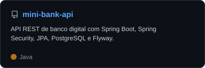
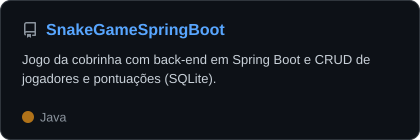
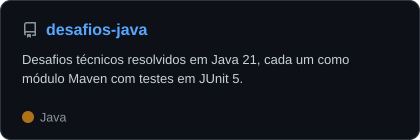
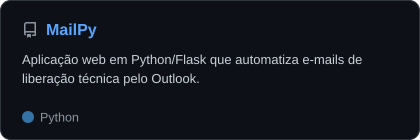
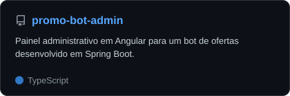
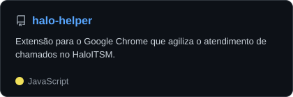
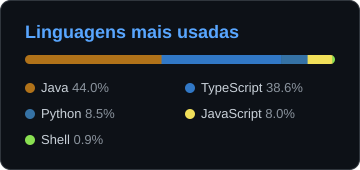

<p align="center">
  
</p>

<p align="center">
  
</p>

<p align="center">
  
  
</p>

---

## 🧑‍💻 Sobre mim

Sou estudante de **Análise e Desenvolvimento de Sistemas** na Universidade São Judas Tadeu e trabalho como **Analista de Service Desk Júnior na Arklok**, onde também desenvolvo ferramentas internas de automação e integrações entre sistemas. Meu foco é o **desenvolvimento back-end com Java e Spring Boot**.

```java
public class LucasMiranda {

    String role      = "Analista de Service Desk Júnior @ Arklok";
    String education = "Análise e Desenvolvimento de Sistemas — São Judas";
    String focus     = "Back-end com Java e Spring Boot";

    String[] whatIDo = {
        "Ferramentas internas de automação",
        "Integrações entre sistemas (Zendesk e HaloITSM)",
        "Dashboards de acompanhamento de chamados",
        "APIs REST e bots com Spring Boot"
    };

    String[] hobbies = { "Arduino e ESP32", "Violão", "Banda" };
}
```

---

## 🛠️ Tecnologias

<p align="center">
  <br/>
  <br/>
  
</p>

---

## 🚀 Projetos em destaque

<p align="center">
  <a href="https://github.com/LucasMir4nd4/mini-bank-api"></a>
  <a href="https://github.com/LucasMir4nd4/SnakeGameSpringBoot"></a>
  <a href="https://github.com/LucasMir4nd4/desafios-java"></a>
  <a href="https://github.com/LucasMir4nd4/MailPy"></a>
  <a href="https://github.com/LucasMir4nd4/promo-bot-admin"></a>
  <a href="https://github.com/LucasMir4nd4/halo-helper"></a>
</p>

---

## 📊 Atividade

<p align="center">
  
</p>

<p align="center">
  <picture>
    <source media="(prefers-color-scheme: dark)" srcset="https://raw.githubusercontent.com/LucasMir4nd4/LucasMir4nd4/output/github-snake-dark.svg" />
    
  </picture>
</p>

---

## 📫 Contato

<p align="center">
  <a href="https://github.com/LucasMir4nd4"></a>
  <a href="https://www.linkedin.com/in/lucas-miranda-aa0430263"></a>
  <a href="mailto:lucas.a.miranda.dev@gmail.com"></a>
</p>

<p align="center">
  
</p>
